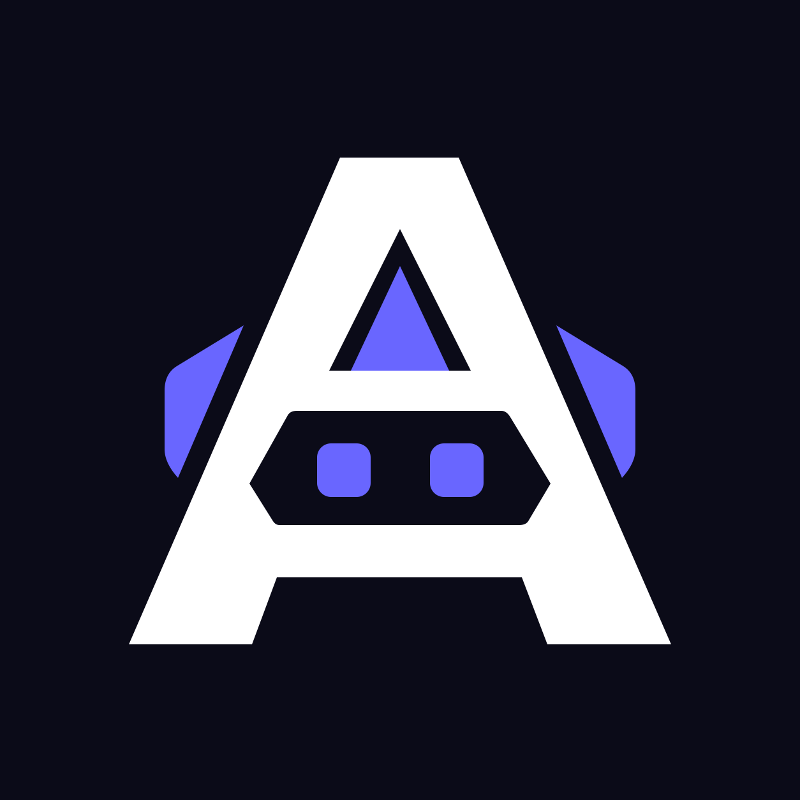

# Welcome to Akilibots! 🤖

Jambo! This repository holds the [Akilibots organization profile](https://github.com/akilibots)
and the shared artwork used across the bot family.

**Updated 22 November 2026:** the profile now reflects Python 3.15.2, dYdX Chain,
the current Binance Spot SDK and Docker regression tests.

- [Organization profile source](profile/README.md)
- [Scalable icon with midnight background](assets/akilibots-icon.svg)
- [Scalable transparent mark](assets/akilibots-mark.svg)
- [PNG icon](assets/akilibots-icon.png)

The SVG files contain vector paths, not embedded raster images. Use them at any
size. The inner triangle, eyes and side pieces share **violet `#6966FF`**. The other
brand colours are **midnight `#0B0B18`** and **white `#FFFFFF`**.
